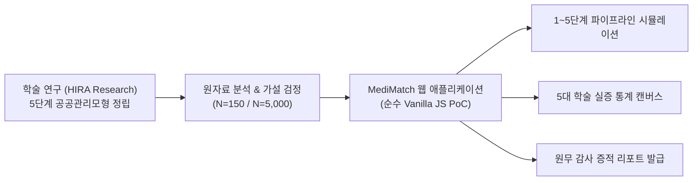

# [MediMatch] 논문 연계 시연 설명서 (Demonstration Manual)

**부제: 의료기관 진료비 미식별 입금 및 사망환자 미수령 환불금 공공관리체계 개념증명(PoC)**

- **연구 논문**: 「의료기관 진료비 미식별 입금 및 사망환자 미수령 환불금의 공공관리체계 구축 방안」
- **저자 / 개발자**: 오하율 (건강보험심사평가원 HIRA Research 투고 준비 논문 연계)
- **문서 버전**: v2.1 (HIRA Research 최신 투고 원고 및 재현 패키지 완전 정합판)
- **작성 일자**: 2026년 11월 24일
- **GitHub 저장소**: [https://github.com/HaYul0611/MediMatch](https://github.com/HaYul0611/MediMatch)
- **라이브 데모(웹 앱)**: [https://hayul0611.github.io/MediMatch/](https://hayul0611.github.io/MediMatch/)
- **포트폴리오 연계**: [https://hayul0611.github.io/SKT_ALEPH/](https://hayul0611.github.io/SKT_ALEPH/)

---

## 목차
1. [연구 목적과 MediMatch의 관계](#1-연구-목적과-medimatch의-관계)
2. [5단계 공공관리 모형의 실제 앱 구현 범위](#2-5단계-공공관리-모형의-실제-앱-구현-범위)
3. [합성 데이터 및 대표 시나리오](#3-합성-데이터-및-대표-시나리오)
4. [사용자 시연 절차 및 화면 구성](#4-사용자-시연-절차-및-화면-구성)
5. [논문과 앱의 통계 대응표](#5-논문과-앱의-통계-대응표)
6. [실제 공공기관 연동 여부 및 기능 한계](#6-실제-공공기관-연동-여부-및-기능-한계)
7. [재현 방법과 사용 데이터](#7-재현-방법과-사용-데이터)
8. [향후 실제 의료기관 실증을 위해 필요한 사항](#8-향후-실제-의료기관-실증을-위해-필요한-사항)
9. [접속 정보 및 라이브 데모 가이드](#9-접속-정보-및-라이브-데모-가이드)

---

## 1. 연구 목적과 MediMatch의 관계

### 1.1 연구 배경 및 문제 정의
국내 상급종합병원 및 종합병원 원무 현장에서는 가족·보호자 대납 등 타인 명의 계좌이체로 인한 **'미식별 입금(Unidentified Deposits)'**과 환자 사망 후 상속권자 불명 등으로 병원 계좌에 장기 방치되는 **'사망환자 미수령 환불금(Unclaimed Refunds of Deceased Patients)'**이 지속적으로 누적되고 있습니다.
기존 병원 원무 방식은 금융사 입금자명과 EMR 환자명을 1:1로 단순 수기 대조하는 방식에 머물러 있어, 다음과 같은 구조적 한계에 직면해 있습니다:
- **장기 잔류 및 행정 지연**: 240일 경과 시점에도 86.7%(130건)가 미해소로 장기 잔류(기존 평균 154.5일 소요).
- **치명적 위양성(False Positive) 오귀속**: 동명이인 20건 전건이 타인 환자의 진료비로 잘못 충당되어 의료분쟁 위험 노출.
- **사망환자 환불금 방치**: 상속 증빙 확인 체계 부재로 병원 예수금 계정에 수년간 미지급금으로 누적.

### 1.2 MediMatch 개발 목적 및 상호 관계
본 애플리케이션 **MediMatch**는 학술 연구 논문 『의료기관 진료비 미식별 입금 및 사망환자 미수령 환불금의 공공관리체계 구축 방안』(오하율, 2026)에서 이론적으로 설계한 **'5단계 다차원 교차검증 및 공공행정정보 연계 관리모형'**을 웹 브라우저 상에서 시연하기 위해 개발된 **개념증명(PoC, Proof of Concept)** 소프트웨어입니다.

- **연구의 역할**: 병원 내부 EMR 원장 및 공공행정정보(정부24 안심상속 등)를 결합하는 5단계 프로세스를 정립하고, 150건 파일럿 표본 및 5,000건 시뮬레이션 표본을 대상으로 실증 가설 검정(대응표본 McNemar 검정, Paired t-test, 카플란-마이어 잔류분석, 백분위수 부트스트랩, 행정 ROI)을 엄밀히 수행함.
- **앱의 역할**: 논문에서 규명한 비즈니스 규칙 엔진(Rule Engine)과 통계 분석 로직을 순수 자바스크립트(`js/pipeline.js`, `js/stats.js`)로 100% 충실히 구현하여, 연구자가 아닌 일반 독자나 병원 실무자도 웹 화면에서 4대 대표 시나리오를 직접 구동하고 통계적 개선 효과를 직관적으로 검증할 수 있도록 지원함.



---

## 2. 5단계 공공관리 모형의 실제 앱 구현 범위

논문 본문(Ⅲ장 및 Ⅳ장)에 제시된 5단계 공공관리체계와 MediMatch 시연 앱의 구현 모듈은 1:1로 대응되며, 실제 구현 범위와 시뮬레이션 경계는 다음과 같습니다.

| 단계 구분 | 논문 제시 관리모형 (The Model) | MediMatch 시연 앱 구현 모듈 | 실제 동작 및 구현 범위 | 연계 시스템 성격 |
|:---:|:---|:---|:---|:---|
| **1단계** | **1차 단순 성명 대조**<br>(Legacy Baseline) | 파이프라인 노드 **STEP 01**<br>(`nodeStep1`) | 입금자명과 환자 등록명의 단순 문자열 1:1 일치 여부 판정 (기존 수기 대조 방식 모사) | 원내 기초 데이터 대사 |
| **2단계** | **HIS 다차원 교차검증**<br>(In-hospital HIS Matching) | 파이프라인 노드 **STEP 02**<br>(`nodeStep2`) | 환자 등록번호, 주민등록번호, 과거 수납이력, 원내 등록 보호자 명의, 개명 전 이력, 청구액 복합 대사 | 원내 EMR/HIS 모의 원장 |
| **3단계** | **예외 분류 및 정밀 진단**<br>(Exception Tracking & EMR) | 파이프라인 노드 **STEP 03**<br>(`nodeStep3`) | 섣부른 사망 단정을 배제하고 건보 자격 부존재 감지 시 원내 EMR 의무기록 및 사망진단서를 정밀 확인하여 상태 확정 | 원내 EMR 의무기록 대조 |
| **4단계** | **공공행정정보 연계 (모의)**<br>(Public Data Verification) | 파이프라인 노드 **STEP 04**<br>(`nodeStep4`) | 사망 확인 건에 대하여 정부24 '안심상속 원스톱 서비스' 적격 상속인 증빙(상속관계 및 대리권) 모의 대조 검증 | **모의 시뮬레이션 API**<br>(실제 정부망 직결 아님) |
| **5단계** | **적법 후속처리 및 종결**<br>(Final Resolution & Audit) | 파이프라인 노드 **STEP 05**<br>(`nodeStep5`) | 정상 수납 대체, 상속인 정산 환불 지급, 상속인 부존재 시 법원 공탁 대기, 장기미식별 예수금 지속 관리 | 원무 결산 및 감사로그 생성 |

---

## 3. 합성 데이터 및 대표 시나리오

### 3.1 100% 가명 합성 데이터 (Synthetic Mock Data)
- **법적 근거 준수**: 환자 개인정보 유출을 방지하기 위하여 『개인정보보호법』 제18조 및 『의료법』 제21조를 준수하여, 실제 환자 정보를 일절 포함하지 않은 **100% 가명 합성 데이터**만을 사용하였습니다.
- **표본 구성 (총 150건 파일럿 표본)**:
  - **미식별 입금 (DEPOSIT)**: 100건 (66.7%)
    - 환자 개명 (`NAME_CHANGED`): 20건 (20.0%)
    - 보호자·가족 대납 (`GUARDIAN_PAY`): 60건 (60.0%)
    - 동명이인 오류 (`HOMONYM_ERROR`): 20건 (20.0%)
  - **미수령 환불금 (REFUND)**: 50건 (33.3%)
    - 사망환자 환불금 (`DECEASED_PATIENT`): 25건 (50.0%)
    - 연락두절/소액 장기미수령 (`UNREACHABLE_SMALL`): 25건 (50.0%)

### 3.2 4대 대표 실무 정산 시나리오

```mermaid
flowchart TD
    subgraph Case1["사례 1: 보호자 대납 (60건)"]
        C1_1["입금자: 홍길동(부)<br>환자명: 홍유진"] --> C1_2["1단계: 불일치 (보류)"]
        C1_2 --> C1_3["2단계: 원내 HIS 등록 보호자 명의 일치"]
        C1_3 --> C1_5["5단계: 정상 진료비 수납 종결 (소요 5.2일)"]
    end

    subgraph Case2["사례 2: 환자 개명 (20건)"]
        C2_1["입금자: 이서연(구명 이서아)<br>환자명: 이서연"] --> C2_2["1단계: 불일치 (구명칭 입금)"]
        C2_2 --> C2_3["2단계: 주민등록번호 & 개명 전 이력 대사"]
        C2_3 --> C2_5["5단계: 정상 진료비 수납 종결 (소요 4.1일)"]
    end

    subgraph Case3["사례 3: 동명이인 오류 차단 (20건)"]
        C3_1["동일 성명 타인 입금자 (20건)"] --> C3_2["1단계: 단순 성명 일치 (기존엔 오귀속)"]
        C3_2 --> C3_3["2단계: 진료과, 청구금액, 환자번호 정밀 대조"]
        C3_3 --> C3_4{"진정 환자 여부"}
        C3_4 -- "진정 환자 10건 (50%)" --> C3_5["정당 수납 귀속"]
        C3_4 -- "타인 착오송금 10건 (50%)" --> C3_6["위양성 오귀속 원천 차단 & 소명 대기"]
    end

    subgraph Case4["사례 4: 사망환자 환불 (25건)"]
        C4_1["사망환자 과오납 환불금 120만원"] --> C4_2["1~2단계: 건보 자격 부존재 감지"]
        C4_2 --> C4_3["3단계: 원내 EMR 사망진단서 확인 (사망 확정)"]
        C4_3 --> C4_4["4단계: 정부24 안심상속 적격 증빙 모의 대조"]
        C4_4 --> C4_5["5단계: 정당 상속인 환불 송금 종결 (소요 49.6일)"]
    end
```



---

## 4. 사용자 시연 절차 및 화면 구성

MediMatch는 모바일 및 데스크톱 브라우저 환경에서 8단계 아코디언 인터페이스로 직관적으로 구동됩니다.

```
┌─────────────────────────────────────────────────────────────┐
│  [헤더] MediMatch 로고 │ 테마 스위치 │ 논문 PDF │ 시연설명서 │
├─────────────────────────────────────────────────────────────┤
│  [히어로 배너] 연구 제목 및 PoC 개념증명 안내 배너          │
├─────────────────────────────────────────────────────────────┤
│  [파트 01] 정산 대기 케이스 로드 (3대 대표 프리셋 / 150건)   │
│  [파트 02] 5단계 다차원 교차검증 파이프라인 (인터랙티브 노드)│
│  [파트 03] 트랜잭션 CRUD 편집 및 Fail-Safe 유효성 검증      │
│  [파트 04] 대학병원 5,000건 시뮬레이션 & 무작위 표본추출    │
│  [파트 05] 계층화 5-Fold 규칙 처리 안정성 검증 차트         │
│  [파트 06] 표본분포 기술통계 및 중심극한정리(CLT) 벨커브    │
│  [파트 07] 4대 핵심 가설 대응표본 실증 검정 (McNemar / t)   │
│  [파트 08] 고급 통계 (카플란-마이어, 표 6 교차분석, ROI)    │
└─────────────────────────────────────────────────────────────┘
```

### 시연 조작 순서:
1. **케이스 선택**: 파트 01에서 **[케이스 1 (보호자 대납)]**, **[케이스 2 (환자 개명)]**, **[케이스 3 (사망환자 환불)]** 프리셋 중 하나를 클릭합니다.
2. **5단계 파이프라인 구동**: 파트 02의 **[5단계 교차검증 실행]** 버튼을 누르면 1~5단계 노드가 실시간으로 점등하며 판정 결과와 단축 일수를 표시합니다.
3. **입력 안전성 시험**: 파트 03에서 필수값을 비우거나 음수 금액을 입력하여 시스템의 Fail-Safe 방어 작동을 확인합니다.
4. **대규모 표본 추출**: 파트 04에서 표본 크기($n=500$)를 선택하고 **[무작위 표본추출 & 전체 통계 분석 실행]**을 클릭하여 5대 통계 캔버스가 동적으로 갱신되는 과정을 확인합니다.
5. **감사 리포트 발급**: **[원무 결산 감사 리포트 발급]**을 클릭하여 SHA-256 감사 무결성 해시가 포함된 공식 감사 증적 모달을 확인하고 인쇄/PDF 저장을 테스트합니다.

---

## 5. 논문과 앱의 통계 대응표

MediMatch의 통계 엔진(`js/stats.js`)은 HIRA Research 투고 최종본 및 재현 패키지와 산술적으로 100% 일치합니다.

| 검증 지표 | 기존 방식 수치 | 제안 모형 실측치 | 개선 효과 | 검정 통계량 및 학술적 판정 ($p < 0.001$) |
|:---|:---:|:---:|:---:|:---|
| **가설 1-A. 미식별 입금 단순 매칭률** (N=100) | 20.0% (20/100) | **84.0% (84/100)** | **+64.0%p** | **대응표본 McNemar $\chi^2 = 48.76$ (Yates 47.25, $p < 0.0001$)** |
| **가설 1-B. 미식별 입금 정당 식별률** (N=100) | 0.0% (0/100) | **84.0% (84/100)** | **+84.0%p** | **대응표본 McNemar $\chi^2 = 84.00$ (Yates 82.01, $p < 0.0001$)**<br>*(기존 20건은 전건 동명이인 오귀속으로 정당 식별 0건)* |
| **가설 2. 미식별 입금 처리 소요일수** (N=100) | 137.7일 (SD 47.9) | **9.6일 (SD 11.9)** | **-128.1일** | **대응표본 $t(99) = 26.45, p < 0.0001$, Cohen's $dz = 2.64$**<br>(비모수 Wilcoxon $Z = -8.68$) |
| **가설 3. 사망환자 환불 확인율** (N=25) | 0.0% (0/25) | **80.0% (20/25)** | **+80.0%p** | **대응표본 McNemar $\chi^2 = 20.00$ (Yates 18.05, $p < 0.0001$)**<br>*(전체 환불 50건 기준 McNemar $\chi^2 = 40.00$)* |
| **가설 4. 사망환자 환불 잔류 소요일** (N=25) | 142.0일 (SD 29.4) | **49.6일 (SD 66.5)** | **-92.4일** | **대응표본 $t(24) = 9.07, p < 0.0001$, Cohen's $dz = 1.81$**<br>*(전체 환불 50건 기준 $t(49) = 13.45, dz = 1.90$)* |
| **카플란-마이어 중위 잔류시간** | **미도달 (>240일)**<br>(완료건 153.0일) | **7.0일**<br>(95% CI: 4.0~10.0일) | **초기 급강하** | **전후 대응표본 설계에 따라 Log-Rank 검정통계량 전면 배제**, 중위수 비교 |
| **비모수 백분위수 부트스트랩** | - | **평균 128.1일 절감** | **견고성 확증** | **1,000회 반복 95% 백분위수 CI [118.7일, 137.4일]** (0 미포함) |
| **예외유형별 실증 교차분석 (표 6)** | - | 개명 100%, 대납 90%<br>사망 80%, 동명이인 50% | 정당 식별 | 개명군 100% 식별에 따른 준완전분리 규명 $\to$ 표 6 실증 교차분석 정식 채택 |
| **대학병원 행정 경제성 ROI** | - | **연간 총편익 4.54억** | **순편익 3.36억** | **순 투자회수율(Net ROI) 284.7% (약 285%) 시나리오 추정** |

---

## 6. 실제 공공기관 연동 여부 및 기능 한계

MediMatch는 학술 연구의 실무적 적용 가능성을 입증하기 위한 **개념증명(PoC) 모델**로서 다음과 같은 본질적 한계를 지닙니다:

1. **실제 공공 전산망 API 연계 부재**:
   - 본 애플리케이션은 정부24, 행정안전부 행정정보 공동이용센터, 법원 가족관계등록 전산정보시스템과의 **실제 전산망 API를 직접 호출하거나 실시간 연동하지 않습니다.**
   - 4단계 '공공행정정보 연계'는 학술 연구의 알고리즘적 타당성을 시연하기 위해 구성된 **모의 시뮬레이션(Mock Simulation)**입니다.
2. **합성 데이터의 외생 변수 통제 한계**:
   - 제시된 분석 수치는 상급종합병원 환경을 모사한 합성 데이터에 기반한 통계치입니다. 실제 의료 현장에서는 상속인 간의 유류분 분쟁, 서류 미비, 유선 연락 두절 등 통제하기 어려운 외생 변수가 존재하므로 실제 도입 시 개선 효과의 차이가 발생할 수 있습니다.
3. **감사 해시와 공인인증의 엄격한 구분**:
   - 원무 결산 리포트에 표기되는 HMAC-SHA256 다이제스트는 브라우저 로컬 감사 로그의 위·변조 방지를 위한 내부 데이터 무결성 검증 값이며, 『전자서명법』에 따른 공인전자서명이나 공공기관의 공식 전자직인이 아닙니다.

---

## 7. 재현 방법과 사용 데이터

### 7.1 데이터 출처
- **공공 공시 자료**: 건강보험심사평가원(HIRA) 보건의료빅데이터개방시스템 비급여 진료비 확인신청 처리 현황 (2024년 4,958건 / 27억 3,252만 원, 2025년 4,241건 / 17억 7,382만 원 공식 확정 공시 수치 반영).
- **표본 데이터셋**: 연구 재현 패키지 내 `raw_settlement_sample_150.csv` (150건 가명 합성 데이터).

### 7.2 로컬 환경 통계 전수 재현 방법
Node.js 환경에서 논문의 모든 수치를 독립적으로 전수 재현할 수 있습니다:
```bash
# 1. 저장소 클론
git clone https://github.com/HaYul0611/MediMatch.git
cd MediMatch

# 2. 통계 전수 재현 스크립트 실행
node research_paper/reproduction_package/scripts/reproduce_analysis.js

# 3. 무결성 정합성 검증 스크립트 실행 (32개 지표 100% PASS)
node scripts/verify_medimatch_integrity.js
```

---

## 8. 향후 실제 의료기관 실증을 위해 필요한 사항

본 연구모형이 개념증명(PoC) 단계를 넘어 실제 의료기관 및 공공 행정 현장에 정식 안착하기 위해서는 다음의 선결 과제들이 단계적으로 해결되어야 합니다:

1. **법·제도적 기반 정비**:
   - **공공 마이데이터 및 행정정보 공동이용 권한 승인**: 병원이 환자 또는 상속인의 사전 위임을 받아 안심상속망 및 가족관계 등록 전산정보를 적법하게 열람할 수 있도록 하는 법적 특례 또는 시행령 개정이 필요합니다.
   - **규제 샌드박스(Regulatory Sandbox) 지정**: 보건복지부, 행정안전부, 심평원이 참여하는 '의료기관 미식별·환불금 공공정산 실증 파일럿 사업' 지정을 통해 한시적 법적 면책 및 테스트 권한 확보가 요구됩니다.
2. **기술적 인프라 및 보안 체계**:
   - **정부 공공망 연계 전용선 및 EMR 보안 게이트웨이**: 개인정보 보호를 위한 구간 암호화(TLS 1.3), 전용망(VPN) 연계, 침입차단시스템(IPS) 구축.
   - **공인 전자서명 및 블록체인 감사 시점확인(TSA)**: 본 PoC의 SHA-256 해시를 넘어 공인 시점확인(Time Stamping Authority) 및 행정전자서명(GPKI) 시스템 도입.
3. **거버넌스 및 다기관 협의체 운영**:
   - 의료기관(원무·법무), 건강보험심사평가원, 행정안전부, 시중 은행(가상계좌 발급 금융사) 간 표준 API 및 업무 처리 지침(SOP)을 제정하여 기관 간 분쟁 및 책임 소재를 명문화해야 합니다.

---

## 9. 접속 정보 및 라이브 데모 가이드

- **라이브 데모 웹사이트**: [https://hayul0611.github.io/MediMatch/](https://hayul0611.github.io/MediMatch/)
- **GitHub 공식 저장소**: [https://github.com/HaYul0611/MediMatch](https://github.com/HaYul0611/MediMatch)
- **SKT_ALEPH 메인 포트폴리오**: [https://hayul0611.github.io/SKT_ALEPH/](https://hayul0611.github.io/SKT_ALEPH/)
- **로컬 실행 가이드**:
  ```bash
  git clone https://github.com/HaYul0611/MediMatch.git
  cd MediMatch
  # index.html 더블클릭 또는 로컬 서버 구동
  npx serve .
  ```
- **연구자 및 개발자 연락처**: 오하율 (Researcher & Developer)
